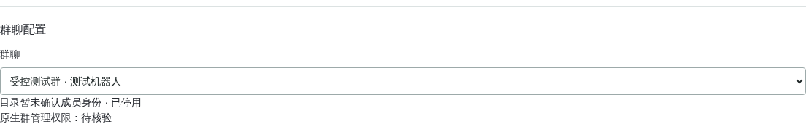

# 隔离入群验收

同步日期：2026-10-20（北京时间）。本页区分工具能力、各轮原始证据与当前缺项；
10月15／16／19日的结论只对应当时执行，不因后续补验改写。

## 2026-10-24 真实 @ 立即禁言及中止收尾

本轮仅测试群1459282，真实@加`黑名单`已验证登记及41760分钟禁言，约2.7秒核实，
测试名单、禁言、临时权限、窗口及账号启停已恢复。后续群内真实@／可核实回复发送
`黑名单`会立即提交本群设置时长；下方10月23日“加入不立即处罚”是旧版本历史。
本轮没有另测真实回复、手机显示或未来实际到期。

固定验收夹具新增`send`，发送前刷新发送账号的完整成员映射，构造真实结构化@；
失败后关闭窗口，经只读核对使用`abort`，持久标记中止而非通过，不额外解禁未被禁言的目标。
未知成员操作、当前测试未知发送及处罚意图仍阻断，不自动重试。
原始摘要差异与已核实的未开通群目录离群变更单列审计，未回滚真实成员状态。
详见[本轮逐项证据与边界](wangshangliao-testing.md)。

## 黑名单代码加载与配置验证（2026-10-23，真实重入未测）

北京时间2026-10-23 20:02:56完整重启已加载，在线配置流程通过，本轮真实新重入／禁言未测。
当前契约：每次可信真实重新入群直接禁言并留群，不再踢人；
加入名单不立即处罚，重复通知、添加、重启或普通发言不续封。
默认29天41760分钟，按机器人＋群配置为1..41760整分钟。
`黑名单禁言时长 N分钟`／`黑名单禁言时长 N小时`／`黑名单禁言时长 N天`，
私信先选群、核对预览后本人新消息`确认黑名单 token`；
后台「群管理 → 规则 → 黑名单设置」同样须预览确认。
只影响后续真实重入，不自动重设已有禁言、不追罚；普通禁言24小时上限及原权限保护不变。
离线边界、取消／撤权／切群及未知结果不重试覆盖详见[当前验收清单](wangshangliao-testing.md)，
不能把离线通过写成新真实重入已处罚。旧通知不套新时长、最后同步权限fence、
确证未提交不误记unknown三项补修已验证；真正unknown保留不重试。

旧“三踢后固定29天”→新“首次起每次重入直接禁言、时长可设”，原三踢证据保留日期，不算新规则通过。
用户「看得见」只记对应手机显示确认，不证明未来真实到期。
20:10:45测试群1459282完成在线41760→60→41760预览／提交／读回，预览不写入；
最初两次读取被普通成员权限保护409拒绝、无写入。43506527临时grant后20:11:18撤权核验、
20:11:22刷新完成；31846829始终owner、23691273未启用，无新踢人或禁言实际处罚。
20:24:00保护复核完成，其他保护面匹配，测试tenant217→220及已审计鼎峰后台并发version4／5保留；
tenants原始整体hash不全同，未覆盖或回滚正式并发修改，不宣称正式群从未变动。
本次文档更新不执行生产操作，重新生成教程／索引／PDF但不向dist同步，详见[维护记录](../../wangshangliao-maintenance.md)。
下文原历史证据保持不变。

## 2026-10-20 三账号警告限定验收

用户接好三条连接后，群`1459282`由群主`31846829`、接收机器人`43506527`、
测试发送者`23691273`复用已有原生连接，通过`test_advertising`完成3次真实警告。
两个独立fixture分别1次、2次，不是同一fixture的完整第1／2／3次升级。
原生`userNick`的`@大蛤`与目标身份核对通过，群名片`testfork`不覆盖该昵称；
原消息撤回、警告接收与自撤回均有对端证据，作者／执行人匹配本地回执。
警告发送受理至对端撤回通知分别12.112／12.115／12.125秒，不等于手机实际消失时间。
测试规则、临时原生管理员角色恢复为原普通成员，窗口关闭；
正式群、财务及正常处罚计数未变，原生回执与最小审计保留。
实测0模型调用、无额外NIM连接、未重启服务；未测禁言升级、全功能或手机画面。
首轮核验脚本误把SHA-256当JSON解析，已只读恢复第一条且未重发，原失败记录保留。
证据：`/opt/backups/wsl-warning-live-20261020-I5Z5qf/result.json`；
详细口径见[测试与验收](wangshangliao-testing.md)，不改写下文较早实测结果。

本页的邀请受控成员、移除、接受邀请、授予／撤销原生管理权限及群主转让验收流程，
只属于本地命令行测试工具，不新增生产插件入口。
生产好友删除能力已移除，测试工具也不提供好友删除。

## 固定范围

- 每次必须用 `--group` 显式指定已授权的受控测试群。`1459282` 是已有测试群，
  不代表全新首轮群；正式群 `1516387`、`1488006` 及任何已有财务规则或账本
  的群一律拒绝，不能用测试参数放行。
- `invite`、`remove` 只由已核实的原生群主 `31846829` 执行，唯一目标是
  测试机器人 `43506527`；`accept` 只由该目标账号接受本轮邀请。不能替换成
  群主、真人、任意账号或批量目标。
- 新增 `grant`、`revoke` 严格限定测试群 `1459282`，只由原生群主
  林夕（`31846829`）操作大蛤【机器人】（`43506527`）。`grant` 只允许
  `MEMBER` 到 `ADMIN`，`revoke` 只允许 `ADMIN` 到 `MEMBER`；角色不符即阻断，
  不转让群主、不修改其他成员角色，也不能扩展到新群首轮邀请范围。
- `transfer-owner` 和 `restore-owner` 是单独的本地测试动作，只允许测试群
  `1459282` 的林夕和大蛤互相转让群主，不向聊天、后台或AI开放。它们不是
  “授予管理员”的别名；仅当前真实群主能发起请求，不能自行提升普通成员。
- 业务账号和 NIM 身份必须与固定 Vault 记录一致。成员目录中唯一允许的额外
  测试成员是普通测试账号 `23691273`，它可以不在群内，但不能成为邀请执行者
  或替代目标；其他成员或不符的身份、原生角色均阻断。
- 旧工具经普通测试账号 `23691273` 重新邀请，是现行策略下的拒绝样例，不是
  成功开通证据。生产开通仍须由真实原生群主或管理员邀请，核实当前成员目录
  和真实业务邀请记录后，由邀请者发送 `开通`。
- `accept` 只能使用同一持久化邀请意图对应的、唯一且新鲜的认证业务
  `applyId`，同时匹配群、目标、真实邀请者、时间和待接受状态。不能手填任意
  邀请编号、接受其他群邀请或重发邀请；缺失、过期或冲突证据均阻断。
- 在测试中核对真实邀请人，不能把群主、审批人或通知发送者当作邀请人。
- 来源以本轮成功的业务邀请记录核验，绑定邀请编号、目标账号、群和邀请者。
  真实测试发现，重新入群后的NIM查询可能仍返回旧邀请者；与业务记录不一致时
  单独记为SDK来源未通过，不能据此归属或转移管理权。开放服务开通同样使用
  业务邀请记录；本工具不修订生产返现归属或历史账本。
- 当前成员查询也核对最新业务成员事件：旧邀请后的踢出、退群、自然入群、
  未接受邀请或同一时间的冲突记录均不能继续沿用旧邀请者。NIM仅用于差异
  核对，不作为奖励归属依据；核验不足时返回未归属。
- 原管理归属在退群重入后保留，新邀请者不能夺权。确认被踢后清理工作规则，
  重新拉入使用默认模板，不恢复已清理的规则和旧处罚。

## 入群与离群策略

- 邀请者必须是完整业务成员目录中的原生群主或管理员。仅以真实成功业务
  邀请记录识别邀请者，不使用群主、审批人、通知发送者或NIM旧邀请查询替代。
- 确认普通成员邀请时先停用，持久化退群意图后只提交一次自身退群。结果不明
  不重试；接口失败或目录暂时缺失不证明已被踢，也不触发删除。
- 来源不明、目录不完整或身份冲突时保持未开通。一次性开通码不能绕过真实
  邀请者的原生管理身份核验；来源不明的历史群需总控核对，不能直接认领。
- 机器人被撤去原生管理权限时保留配置、管理员和数据，停止处罚及相关定时
  动作。重新授权后仅执行未来动作，不补发旧处罚。
- 只有收到影响本机器人自身的原生退群／踢出通知，并由认证业务目录确认
  当前已不在群内，或本轮自身退群有成功回执且目录确认离群，才清理工作数据。
- 清理仅限当前机器人账号和该群：规则、违规计数、待执行任务、群消息内容
  和旧确认／开通码。保留原管理归属、最小审计及未知结果回执、去重标识。
  返现账本、邀请归属、金额和未结账数据不删除，也不改变其他群或机器人。
- 重启后恢复未核验离群的阻断及未完成清理；清理完成前不得重新开通。离群
  通知晚于后续入群时，以最新成员事件核对，不删除当前已重新加入的群。

后台群聊选择器与状态区域显示待核验、撤权暂停、退群结果及清理进度。
以下截图隐去了账号及群名称，只表示页面状态，不代替真实入群验收。



## 开通回复与好友菜单

群主或群管理员邀请机器人后，由邀请者在群里发送 `开通`。未开通群也会
收到本次命令的结果，不需要先和机器人私聊，也不需要单独打开群主动发言。
如果机器人已经退群，群里的命令它收不到，请群主或群管理员重新邀请。
提示直接说明未开通原因和下一步；成员身份、邀请来源和暂停限制不因此放宽。

首次添加好友并确认同意后，私聊发送文字菜单和带“大海”Logo的功能图。
自动同意和手机手动同意都可触发，每账号、真实私聊身份只发送一次。
已有好友不批量补发；重复添加、重启和首次普通私聊共用同一发送标记。
文字发送结果不明时不继续发图，也不自动重发，用户仍可发送 `菜单` 查看命令。
同意动作仍逐个进行，至少间隔30秒；欢迎消息之间至少间隔3秒。
好友同意暂停不会被欢迎消息解除，删除好友仍无后台、聊天或AI入口。


## 自动广告递进隔离验收

后台内部白名单 `test_advertising` 只绑定已有短时测试窗口，不是聊天命令，
也不提供任意路径、目标、接口或角色修改。仅限群 `1459282`，林夕为真实群主、
大蛤为真实管理员、`23691273` 为普通成员，完整目录必须恰好包含这三个账号。
测试仍须遵守现有角色变更额度和冷却；额度不足须另行确认，不自动提高。

窗口仅含 `group_rules`，最长300秒、恰好六条测试消息和一个唯一标记。
服务端固定创建 `test-advertising/<唯一标记>/moderation.sqlite3`，只隔离本轮
警告和递进禁言计数，不删除、清零或覆写原处罚历史。真实消息接收、规则判断、
原生权限检查、撤回和禁言均沿用原执行链；原生操作回执仍在原操作库。
结果不明保留占用，不因测试库缺少回执而假定未执行，也不自动重试。

窗口关闭、过期、替换，或账号、群配置及管理授权变化后，等待中的动作停止；
已返回的执行结果仍留存到原绑定测试库，不回落写入生产计数。
离线回归通过不代表手机客户端或平台实测通过。实际验收须分别留证前三次
撤回警告、5／15／60分钟递进、对端撤回通知、禁言效果及最终解禁恢复。
测试结束关闭窗口、恢复规则和原生角色，核对正式群开关及财务字段未变。

### 2026-10-19 实测补验

北京时间2026-10-19（UTC 2026-10-18），经明确授权维护重启及第二组固定
授予／回收后，已在 `1459282` 完成真实六消息补验：

- 前三条逐条撤回并发送第1／2／3次警告，没有禁言；普通测试账号独立收到
  三次警告及六条消息对应的原生撤回通知。
- 后三条分别取得5／15／60分钟禁言成功回执；每档同时核对真实禁言名单，
  确认普通测试账号处于禁言状态。每档测试后依照冷却解禁，不等待自然到期。
- 最后一次解禁后另发一条普通消息，平台接受且大蛤真实接收；该补查未增加处罚。
- 测试窗口关闭，规则和主动发送设置恢复；林夕仍为群主及唯一业务管理，大蛤
  已从临时原生管理员恢复普通成员。原警告／处罚计数及旧测试日志前缀未变。
- 相关回归1113项通过、零跳过；财务1468条字段指纹一致，两个正式群的四个
  绑定仍暂停。没有模型调用，也未解除好友审批异常暂停。

证据位于服务器受保护目录
`/opt/backups/wsl-advertising-live-20261019/`，包括 `verification.json`、
`recovery-verification.json`、独立收件及撤回回执、`pytest.xml` 和前后财务审计。
本结果只补齐自动广告递进与恢复，不代表首次开通、全部功能或生产灰度已通过，
也不是新增的手机客户端画面确认。

## 执行

以root运行下列CLI时，每条命令均使用`ASTRBOT_DISABLE_FILE_LOGGING=1`，
仅关闭本地CLI初始化文件接收器，不改运行服务日志。测试工具不自动停启服务；
预览也会读认证平台并写私有测试日志，不是离线模拟或无副作用检查。

以下是独立本地 CLI `scripts.wsl_test_lab` 的受控测试流程，不是已完成验收
的声明。命令中的群 ID 必须由获授权操作者提供；预览会读取认证平台状态并
保存本地预览，不提交平台写操作，也不是离线模拟。

先选择一个动作生成预览：

```bash
env ASTRBOT_DISABLE_FILE_LOGGING=1 .venv/bin/python -m scripts.wsl_test_lab --group <testgroup> --action invite
```

移除和接受邀请也分别预览，不能一次执行整轮：

```bash
env ASTRBOT_DISABLE_FILE_LOGGING=1 .venv/bin/python -m scripts.wsl_test_lab --group <testgroup> --action remove
env ASTRBOT_DISABLE_FILE_LOGGING=1 .venv/bin/python -m scripts.wsl_test_lab --group <testgroup> --action accept
```

预览显示 `preview` ID 和有效期10分钟的一次性确认口令。本地独立日志位于
`/opt/backups/wsl-test-lab/control.sqlite3`，只保存口令哈希，不保存口令原文。
核对动作、群、执行者、唯一目标、成员和保护指纹后，使用对应预览执行：

```bash
env ASTRBOT_DISABLE_FILE_LOGGING=1 .venv/bin/python -m scripts.wsl_test_lab --group <testgroup> --apply --preview <preview-id>
```

程序通过 `getpass` 隐藏输入确认口令，不把口令放入命令行参数、脚本或日志。
`--apply` 不再带 `--action` 或 `--first`；动作和范围已经绑定预览。过期、
已使用或状态已变化的预览不能执行。

结果不明时只核对已有操作：

```bash
env ASTRBOT_DISABLE_FILE_LOGGING=1 .venv/bin/python -m scripts.wsl_test_lab --group <testgroup> --reconcile <attempt-id>
```

操作 ID 对应已登记的本轮预览 ID。`--reconcile` 只读取现有操作的认证结果并
更新独立本地日志，不提交新的平台写操作，不与 `--apply` 混用。

### 首轮邀请

若要检查全新群的首次邀请路径，由原生群主先在官方客户端创建受控测试群，
提供群 ID，再预览：

```bash
env ASTRBOT_DISABLE_FILE_LOGGING=1 .venv/bin/python -m scripts.wsl_test_lab --group <fresh-testgroup> --action invite --first
```

`--first` 只适用于邀请，不要求先踢出成员，也不删除历史授权、租户或审计来
制造“首次”。除本地历史开通／审计和群退役记录外，还检查目标业务账号
`43506527` 当前返回的最新申请／邀请日志；发现该群、该目标的历史记录时
拒绝首轮路径。返回日志无匹配不等于已证明平台全部历史为空，已有群不能据此
冒充新群。没有合规全新群时停止并保留缺口。当前没有可靠核实的建群、加好友
请求结构，工具不猜测或编造这些接口。

邀请或入群结果 `verified` 只证明本轮成员操作有对应证据，不证明首次开通、
默认规则、原生权限及后续全部功能均已验收。首次完整激活还需独立的真实
邀请来源、原生身份、`开通` 结果和后续功能证据，不能从一次邀请成功推断。

2026-10-16获授权的旧群归零仅是替代测试，必须标注
`reset_existing_group=true`、`genuinely_new_group=false`。
`reset_wsl_test_group.py`默认离线预览，`--apply`要求共享AstrBot与独立结账
双服务已停止、相关数据库无人持有；工具不自行停服务。仅重置固定租户工作状态，
保留账本、授权安全边界、`departure_verified`、原始审计及未知回执。
重置完成、接受邀请、真实邀请者发送`开通`及原生管理员权限是独立证据；
不要清理历史再用`--first`冒充新群。详细维护前置条件见
[现行测试与验收](wangshangliao-testing.md)。

### 原生管理角色验收

`grant`、`revoke` 是本地隔离测试动作，其官方原生接口路由已从官方APK核实。
上述补验已有本轮授予及恢复的真实证据；单独核实路由仍不等于执行通过。
仅使用以下固定测试范围预览：

```bash
env ASTRBOT_DISABLE_FILE_LOGGING=1 .venv/bin/python -m scripts.wsl_test_lab --group 1459282 --action grant
env ASTRBOT_DISABLE_FILE_LOGGING=1 .venv/bin/python -m scripts.wsl_test_lab --group 1459282 --action revoke
```

两条命令是不同角色前置条件下的独立预览，不可直接作为连续执行脚本。完整
认证成员目录必须确认 LinXi 仍是原生群主，DaHa 在群内且具有动作要求的
当前角色；这两个角色动作必须恰好包含三个固定账号，`23691273` 必须保持
普通成员角色。账号和 NIM pin 仍以固定 Vault 核对，不按显示名称授权。

每个动作均复用前述独立预览、10分钟一次性口令、`getpass` 确认和单次
`--apply --preview` 流程，受同一本地日志的锁、完成后限速、每日额度和未知
结果不重放约束。回执后还须读取认证成员目录，核对目标角色及其他成员未变。
原生角色授予不是插件管理授权，不改变生产请求白名单或生产聊天命令。

开始前记录目标原角色，结束时必须恢复并再次核对。通常为 `MEMBER` 经
`grant` 变为 `ADMIN`，再为 `revoke` 单独生成新预览、确认执行，恢复
`MEMBER`；若从 `ADMIN` 开始测试撤权，则另行预览、确认 `grant` 恢复
`ADMIN`。恢复同样消耗写额度并遵守间隔，不能为恢复绕过保护。结果不明时先
核对已有操作，不盲目反向执行或重发；无法证明已恢复时记录未完成，不宣称
测试通过。恢复角色不重放旧处罚，也不删除或重置历史管理授权。

每轮动作仍须单独留存真实结果，不能沿用上述补验代替新一轮证明。原生成功
回执和目录角色变化也不代替手机客户端的可见画面证据。

### 群主转让测试

测试禁言、撤回和活动只需要大蛤具备管理员权限，通常应使用前面的 `grant`，
不需要转让群主。确需验收群主转让时，使用两个明确分开的动作：

```bash
env ASTRBOT_DISABLE_FILE_LOGGING=1 .venv/bin/python -m scripts.wsl_test_lab --group 1459282 --action transfer-owner
env ASTRBOT_DISABLE_FILE_LOGGING=1 .venv/bin/python -m scripts.wsl_test_lab --group 1459282 --action restore-owner
```

以上只是不同前置条件下的预览，不能直接连续执行。`transfer-owner` 要求林夕
当前是群主，大蛤是成员或管理员；`restore-owner` 要求大蛤是群主，并且同一
审计库已有成功回执及完整角色核对的前向转让。转回的预览绑定原转让记录，
不接受未留证的手机端转让作为测试工具自己的成功证据。

每次预览仍须单独使用 `--apply --preview` 和隐藏输入的一次性确认，提交前
及共享HTTP锁内重新读取完整成员目录、身份和保护指纹。三个账号须全部在群、
身份正常且UID／NIM一致，第三人角色不得变化。回执和目录不一致、超时或
取消后结果不明时停止，只能核对，不自动重发或反向转回。

平台可能将原群主降为成员或管理员，工具记录实际角色，不假定转回后大蛤
仍保留原管理员权限。`role_restore_required` 为真时，须另行预览 `grant`
或 `revoke` 恢复原角色；群主转回的成功不等于整轮状态已经恢复。
转让前至少须有两次剩余写额度，为单独转回留出空间，但不会自动提交转回。
全部动作复用同一份 `/opt/backups/wsl-test-lab/control.sqlite3`，不得换库、
删计数或清历史。新增动作未执行真实转让前，不标记真实验收通过。

### 操作保护与旧入口

工具使用共享持久化日志和跨进程排他锁，并发运行失败而不是并行写入。每次
请求完成后至少等待3秒才发送下一请求；每次写操作完成后至少等待30秒才发送
下一写操作。间隔跨进程和重启保留，每个 UTC 自然日最多预留10次写操作。
CLI可显式指定 `--daily-write-limit 20`，最多二十次；它和三账号验收脚本
共享累计次数，不会重置历史，也不能任意提高上限。
仅在操作者明确批准补验时，可额外指定 `--extra-role-pair-day YYYY-MM-DD`
（当天UTC日期）追加固定测试群 `1459282` 的一组 `grant`／`revoke`：
只允许第21次授予大蛤管理员、第22次回收本次已核验授予，预留回收额度。
此参数必须同时使用 `--daily-write-limit 20`，默认只支持第一轮，不支持其他群、
邀请、移除或群主转让；不删除历史，不改变默认额度或30秒写冷却。
两个动作仍分别预览、确认并核对原生角色；不属于生产功能或平台额度。
若第二轮补验另获明确授权，可同时指定 `--extra-role-pair-round 2`，
严格限第23次授予、第24次回收；授予前必须存在当天第一轮已核验成功的回收记录。
第二轮确认绑定轮次，不能借用第一轮确认或继续第三轮；不提供任意次数上限。
写操作先持久化意图，拒绝、超时或未知结果都不自动重放。未核对完的操作
阻断新的无关写入；同轮待接受邀请只有完成上述精确核验，才允许单独预览
`accept`。不能靠换预览、删日志或重启绕过保护。

上述跨进程间隔、锁和每日额度仅约束共享这份固定本地 CLI 日志的测试进程。
独立生产运行时的平台轮询使用其他业务客户端，不共享此日志的锁和计时；
这里不保证整个账号的全部请求流都满足同一间隔，也不保证账号永不触发限流。

真实群身份、完整成员范围、固定 Vault 身份或原生角色不能核实时，在写入前
停止。执行前后核对财务字段、群规则、正式四绑定和配置保护指纹；不删除、
重置历史授权或历史财务数据。工具本身不重启服务或启用正式群；接收或执行
代码更新需要维护重启时，须另获明确授权，不能当作测试的自动步骤。

工具不注册生产 HTTP、聊天、API、AI 或 MCP 入口，不开放任意 URL、方法或
载荷。邀请和接受邀请接口不在生产请求白名单中；移除成员（`REMOVE`）已经是
正常受审查的生产 API，测试工具不扩展它的生产授权或白名单范围。新增角色
动作也不修改生产白名单或命令。独立测试状态保存在权限受限的
`/opt/backups/wsl-test-lab`，不靠修改生产规则完成验收。

旧 `scripts.check_wsl_integrated_live --phase membership` 普通邀请者流程已停用，
旧整轮 `--full` 也不能作为当前安全验收入口。不要继续使用旧命令，或把旧的
宽范围工作流测试描述为当前安全、全部通过的验收工具；成员操作改用上述
独立 CLI，其他旧阶段也不因此获得执行授权。

## 当前实测范围

2026-10-15 已记录的真实群 `1459282` 测试仅完成 `remove` 预览：只提交原生
只读查询，三个已知受控 UID 的角色匹配。普通测试账号 `23691273` 本轮核对的
Vault NIM pin 为 `1111308056`；运行时仍须匹配固定 Vault 身份，不能用文档
数值覆盖身份校验。本轮未提交真实移除、邀请或接受邀请写操作，相关服务 PID
未变化。这不构成真实邀请、接受邀请或首次开通通过的证据。
该段记录的是10月15日当轮范围，后续补验不覆盖或删除原始证据。

### 2026-10-19 三账号真实补验

本轮复用林夕 `31846829`、大蛤 `43506527` 和普通成员角色的受控账号
`23691273`，没有增加登录；所有原生群写操作仅作用于测试群 `1459282`。
通过测试专用预览及确认临时授予大蛤管理员，结束后独立核对已恢复普通成员。
该原生角色变更不转移插件管理归属。

- 受控普通成员通过真实群消息报名抽奖，持久化报名及中奖身份一致；
  开奖通知由另一现有连接独立接收。开始和开奖使用明确标记的后台测试控制，
  不冒称群主聊天控制、真人领奖或真实奖品发放。
- 普通成员真实禁言一分钟后，发送被平台以 `802` 拒绝；未手动解禁，
  75.95秒后禁言名单为空，原连接发送恢复并被机器人收到。
- 独立名片测试使用真实 `CardJobs`、操作入口和原生接口，完成短测试名修改、
  原名恢复及逐次成员目录核对；未修改群主或大蛤名片。该项不是聊天改名片证明。
- 首次长测试名请求结果不明；保留原未知记录，随后只读核对原名仍在，
  留存人工核对记录后才为短测试名创建新的预览。没有重放旧请求，
  也未把短名成功认定为已经证明平台的长度上限。
- 当前咨询及热群人格分别完成一次真实 DeepSeek 调用，读取各自隔离测试知识；
  未向模型提供生产账本或其他用户资料，未打开公共 AI 门禁。

证据位于 `/opt/backups/wsl-real-acceptance-20261019/`、
`/opt/backups/wsl-three-live-20261019T065403Z/` 和
`/opt/backups/wsl-three-card-live/2d91ff9c4e33447cae33ecdb50d92af7/`。
正式账本和正式群开关保护摘要保持一致。已有群的补验不是新群首次开通证明，
受控机器人账号的普通成员角色也不等于真人账号。

## 尚未通过的验收

截至2026-10-20，供应商有限额度配置已有认证证据：
`/opt/backups/wsl-ai-enable-20261020T0724Z/enable.json`记录`quota_limited`及本地确认，
但`supplier_exhaustion_tested=false`，不宣称实际耗尽后拒绝已通过。另在
`/opt/backups/wsl-group-ai-20261020-format/runtime.json`记录222项相关回归及
北京时间15:47:56的群AI自动发送`accepted`，本轮没有另发群测试消息，
手机确认仍为false。默认拒绝未确认预算不等于当前运行预算未确认；
也不能为复用旧脚本而关闭已经获授权的群AI或恢复旧双账号／正式群暂停基线。

本地模拟不等于真实邀请。旧测试群重置／重入、部分原生管理与恢复通过，
不等于全新群首次邀请开通。欢迎原生图片接收回执不证明首次新好友或手机显示；
2026-10-15已有用户确认自动撤回画面，不能因此将其他手机项目一并标为通过。
供应商额度耗尽拒绝、Access登录后的真实登记／撤回、真实故障演练和生产配额下
持续负载仍须独立证据。用户已于北京时间2026-10-17取消旧10%查询相对增幅
上线阻断，现记录绝对P95；这不改变旧失败，也不构成持续SLA通过。
增加测试CLI、邀请成功或只读观测不能补齐上述缺项。

机器人接收手机客户端群撤回通知时，仅记录群、消息、操作人和时间等
元数据，不保存消息内容，不执行任何处罚。记录按机器人账号隔离、去重，
保留90天。手动撤回的通知不等于机器人规则撤回的客户端画面验收。
