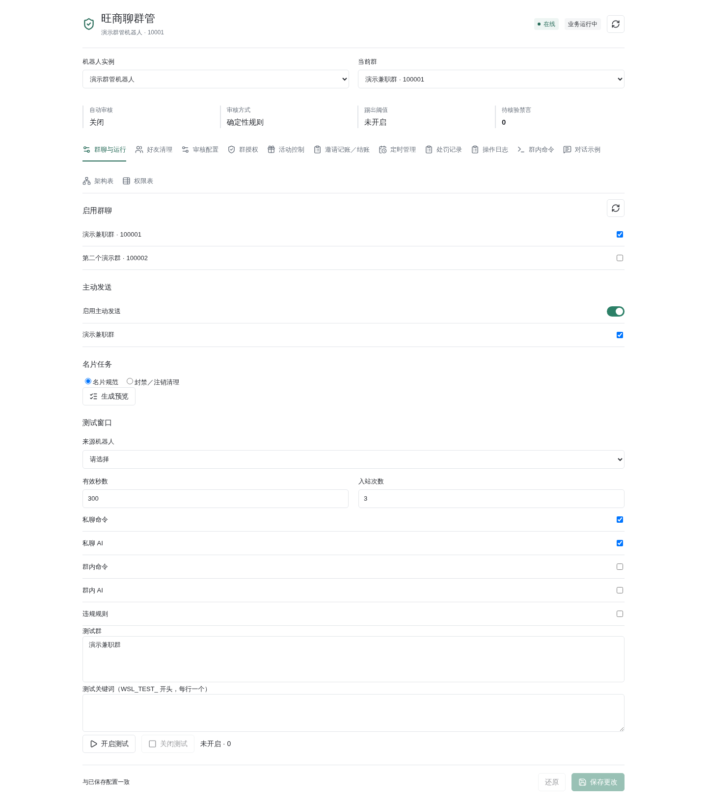
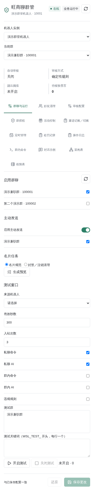

# 接入器与插件配置迁移

当前防刷屏按同一账号、群及成员计数，包含普通群命令：5秒3条、10秒8条，
或30秒同文5条，不等待模型；原有禁言历史保留，不补处理旧消息。

更新：2026-10-20。2026-10-07迁移构建与2026-10-08部署是历史节点；
当前公共机器人已集成于共享AstrBot，独立结账服务仍保留。
旧`astrbot-open.service`与公共`control.sock`不恢复；结账专用`cashier.sock`
仍承担受限写入及诊断桥接。代码回归或部署成功均不等于全部线上功能验收。

2026-10-20后续三账号警告实测已通过，范围仅限`1459282`两个隔离fixture的3次警告（1＋2次），
不代表完整三级升级、全新群开通、财务或手机画面验收；详见[测试与验收](wangshangliao-testing.md)。
本轮冗余整理仅合并等价回复调用／关键词校验并删除未使用的旧头像定价迁移函数，
没有执行迁移、清理数据库或修改历史财务行，也未重载／重启后端或发送消息。

## 入口映射

| 原入口：机器人页面 | 迁移后入口 |
| --- | --- |
| 登录、验证码、启停、退出、连接状态 | 仍在机器人页面 |
| 勾选启用群、主动发送授权 | 公共模式：旺商聊管理 → 群管理 → 开通与规则；旧群聊与运行页仅属兼容模式 |
| 名片预览、执行、清理、进度 | 兼容群聊与运行 → 名片任务；当前合并页隐藏该页签，不能宣称已有等价可见入口 |
| 测试来源、范围、期限、次数 | 兼容群聊与运行 → 测试窗口；合并模式保留受保护API，不代表旧面板仍可见 |
| 逐群能力、名片后缀、自动规范 | 群管理 → 开通与规则／群授权，按实际能力及平台角色核验 |
| 模型关联、回复、审核参数 | AI服务 → 客服咨询／群聊与热群／模型与预算；旧审核配置页在合并模式隐藏 |
| 业务配置变更和错误 | 运行与日志 → 操作日志／群管审计 |
| 自动同意好友、异常核对 | 群管理 → 好友申请；不提供好友删除 |
| 登录管理员、模型、人格、知识库 | 保留 AstrBot 原有入口 |
| 现金付款登记、CF Access 与联系方式 | 保留独立结账页 |

机器人页面分别显示连接与业务状态。在线不等于插件已启用，也不代表拥有群管理权限。
群目录只展示平台实际返回的群；平台分页完整性未证实时不得标记为完整目录。
新增勾选群会刷新目录，不重新登录；业务保存不调用机器人终止或重新加载。

当前`App.vue`在合并模式隐藏`business/settings`页签，名片任务及旧测试面板仍位于
`BusinessControls.vue`。这是源码确认的可见入口缺口，本轮未做浏览器验收；
不要为恢复旧面板切回已退役独立模式或放宽API权限。以下为历史离线演示，
不是当前合并导航或生产验收截图，不包含生产配置或真实成员：




## 唯一配置与权限

插件的 `data/plugin_data/wangshangliao_moderation/settings.sqlite3` 保存机器人实例与
真实账号绑定的基础业务配置、版本、生效时间与变更历史。
公共逐群租户、权限、AI及额度由`wangshangliao_open/open-service.sqlite3`管理，
运行时叠加基础快照，不以旧实例配置覆盖租户规则。网页及获授权固定命令按各自版本化入口写入；
所有公共聊天AI均无配置或管理写工具，旧管理员AI写配置说明只属历史。
活动、现金、成员历史和原执行账本仍在原位置，不在此迁移中转换、合并或重建。
旧页面兼容请求仅允许单独更新业务；不能在一次请求里同时更改连接和业务参数。
版本冲突必须刷新重审，不能覆盖。迁移后数据库缺失不会用空默认值重新建业务策略。

| 调用方 | 可读取／操作 |
| --- | --- |
| 普通用户私聊／群内 @ | 私聊`/chat`咨询；群@须逐群开启并通过门禁；公开固定命令独立，无AI群管工具 |
| 管理员群内 @ | 启用时仍为客服，不进入自然语言配置确认 |
| 管理员私聊 | 仅当前获授权的固定管理命令可预览／确认；AI只解释，不写配置 |
| WebUI 已认证管理员 | 有机器人管理权限时访问插件设置及日志 |
| 接入器执行器 | 提交前检查当前策略、账号、群、成员和平台权限 |
| 插件停用后的连接 | 保留只读观察；禁止新增回复、处罚和配置写入 |

停用撤销运行代次、测试窗口和待执行回复。旧事件即使模型稍后返回也不能发送或调用管理工具。
冷启动不重放旧聊天命令；邀请通知证据单独保留。重启时接入器只能从策略库只读恢复
观察群范围，不能据此获得业务执行授权。配置草案在插件卸载时清空。
暂停、掉线及读取目录失败不触发离群清理。只有当前账号的离群核验和持久化代次驱动
精确群工作数据清理；财务与未知动作证据保留。清理按库提交，不是跨库原子事务。

普通文字自主接话必须另行逐群开启，只传筛选后的有界群聊上下文；
冷场发话是独立开关，`mentions`也独立于`autonomous`。群@、自主接话和冷场话题
均按`profiles.resolve("group", account, group)`使用群聊配置及账号／单群覆盖，不走私聊咨询人格。
共享群人格，但群@只带本人新@会话中配置允许的有界历史，不跨成员、群、账号或私聊，
不迁移或复用旧群客服咨询历史；自主候选缓存及原`/group`来源不变。
群输出为纯文本，不加`【群聊AI】`或`【客服咨询】`前缀；私聊只读AI行为不变。
三种群模式
均受预算、扣费人、当前权限、额度和时段检查，不是“所有群@永不触发AI”。
好友读取至少间隔3秒、自动同意至少间隔30秒，另有扫描周期与持久化退避；
未知审批仅后台读回核对，开关不清暂停。首次引导先持久化认领，
未确认投递不自动补发，固定原生图片不会在欢迎路径自动上传。好友删除入口不得恢复。

操作日志记录操作者、实例、版本、前后业务值、结果与错误码，不包含登录密码和会话凭据。
日志为有界查询，凭据备份绝不能作为操作日志或截图公开。

## 备份与回滚

先在测试环境操作。备份目录必须是新目录，不覆盖已有备份：

```sh
PYTHONPATH=. .venv/bin/python scripts/wsl_policy_migrate.py backup \
  --data /opt/astrbot-prod/data --output /secure-backups/wsl-before-migration
```

备份使用 SQLite 在线备份接口，校验数据库完整性，并生成 SHA-256 清单。
覆盖原始配置、加密会话文件及旺商聊相关 SQLite 账本；目录和文件只允许服务账号读取。
跨数据库的业务一致性仍要求切换时停止业务写入，不能把在线备份误认为多数据库原子快照。
共享AstrBot与独立结账服务均须协调停写。清单需包含原生目录及集中
`wangshangliao_moderation`、`wangshangliao_open`、`wangshangliao_cashback`目录、
账号目录绑定索引、好友审批与首次引导库、模型和Access侧文件。
业务目录按账号绑定，密封会话仍按实例绑定，两者可能不同。
旧`wangshangliao_maintenance.py backup`不覆盖集中业务库，不能代替这里的完整旺商聊备份；
全局人格、知识库及AstrBot对话库需另行备份。

回滚代码前，将**最新**插件配置导出到新文件：

```sh
PYTHONPATH=. .venv/bin/python scripts/wsl_policy_migrate.py export \
  --data /opt/astrbot-prod/data --output /secure-backups/wsl-latest-config.json
```

导出会核验账号绑定，只生成兼容配置，不修改运行配置或财务账本。
维护人员应停写后核对再恢复旧代码。禁止拿迁移前账本覆盖新产生的付款、邀请或抽奖记录。
导出仅合并基础策略，不会转换公共租户、群AI、套餐、预算或逐域知识，
不能把导出成功等同公共合并模式可无损降级。不得为回滚恢复旧公共socket或AI写工具。

### 替换返现采集机器人

删除机器人实例不会删除独立返现账本，但账本仍绑定原采集账号，不能只改实例 ID。
维护迁移使用 `migration.migrate_cashback_collector`，仅限已备份、暂停写入后的管理员操作，
不向私聊、AI 或普通结账员开放。新账号必须已加入对应群，并提供五分钟内读取的完整名单；
原实例、账号和群设置版本不符，或成员身份冲突时整笔事务拒绝。

原记录 ID、邀请归属、金额、结账登记和历史价格保持不变。旧邀请证据保留原采集账号，
仅通过群和新账号限定的 `collector_migrations` 授权继续核验，截止时间不会随再次迁移扩展。
当前名单中尚无账本记录的成员只建立零金额基线，不重复计奖；重新启动不重置结账员手动
确认的代理商价格。独立结账页与插件共用 `access.json` 中的 `collector_id`，新实例的
业务配置还需勾选该群，不复制旧账号的处罚权限。

迁移后先重新采集真实名单和邀请来源才能结账。观察中断超过两分钟的未结账成员按原安全
规则重新核验三小时；已登记付款不回退，确认离群的未结账记录作废。未证实新账号已加入的
其他群保留历史数据，不能自动授予访问或采集权限。

断档期间新入群却被建立为迁移基线的成员，须由管理员通过内部维护函数
`recover_cashback_migration_entries` 逐条补账，不向网页、私聊或 AI 开放。仅接受指定
迁移时刻建立、未经处理、未付款、未退群的零金额记录，核对当前完整名单与唯一的已通过
邀请来源、双方身份和原价格；先预览，备份后原子提交并逐条审计。自然入群、来源不明、
重复邀请、身份冲突或已处理记录均不补造返现。申请时间不作为实际入群时间，补账后重新
核验三小时，不直接进入待结账。

历史已结账记录若仅凭入群操作人错误归属，管理员可用内部维护函数
`detach_unverified_paid_inviters` 清除无可靠来源的邀请人字段；原金额、已结账状态、
付款登记和原收款人审计保持不变，页面显示“已结账 · 归属待核对”，个人邀请统计不计入。
已付款后的另一次入群不重分配原付款归属，也不产生第二笔返现。

## 上线门槛

刷屏兜底按账号、群和成员隔离：10 秒内达到 8 条消息或 30 秒内相同文本达到
5 条触发，普通群命令同样参与计数，不依赖模型判断。过期消息、重复事件不累计。
开启递进处罚后，前三次成功撤回不禁言，随后撤回并禁言 5、15、60 分钟，后续封顶 60 分钟。
前三次撤回额度持久保存，不因重启重置；失败或未知撤回不增加成功次数。
历史禁言记录继续保留并用于升级，未恢复自动踢群。

“当前群”显示群目录中的实际群名称，并保留群 ID 用于区分同名群；名称缓存缺失时，
管理页向已登录账号的群列表补查，不以群 ID 冒充名称。

隔离服务链路验收使用临时数据库和模拟平台接口，覆盖停用留存证据、恢复旧价核验、
切换采集账号、旧采集账号拒绝、退群重拉作废以及事务提交前停用回滚。
这不等于真实平台端到端验收，生产账号的连接和邀请投递仍须独立验证。

现金账本新增按群、版本、生效时间保存的返现规则历史。延迟收到的可靠邀请证据，
如果早于当前单价的生效时间，须匹配当时采集账号和已启用规则，才能使用历史单价。
旧数据库没有留下的历史不会按当前金额补造；此类记录保持待核对。已登记付款的金额不改写，
后续证据发生金额冲突时标记核验冲突并保留付款记录和操作日志。

- 验证重复导入、保存失败后重试、丢库拒绝、版本冲突和账号绑定。
- 验证停用／取消勾选／撤权后的排队执行被阻止；连接继续在线。
- 验证桌面和手机的群名、任务预览、确认按钮及错误提示。
- 邀请恢复必须以真实发生时间、可靠归属和当时金额为依据；缺少历史快照时只能待核对。
- 完成跨停用期邀请、历史单价、切换采集机器人和财务并发验收后，才能生产切换。
- 不通过实际付款或批量处罚生产成员验证迁移。

离线测试不能代替真实平台验收。2026-10-08 已按部署请求切换生产，
实际完成项及未完成的平台验收见
[部署验收记录](wangshangliao-acceptance-20261008.md)；不要将部署成功等同全部功能实测通过。

2026-10-20补充只读依据：
`/opt/backups/wsl-group-ai-20261020-format/runtime.json`记录选定群
群内@回复和自主接话已启用、冷场关闭、就绪且修复后一次自主接话发送`accepted`，
原生会话2条消息、1421 token；不代表所有群已开启或手机显示已确认。
`/opt/backups/wsl-ai-enable-20261020T0724Z/enable.json`记录硬预算核验，
供应商限额1000 USD、应用月预算20 USD，启用脚本模型调用为0、未测试供应商额度耗尽。
这些是历史时点快照，不是本轮在线重验。本轮只改文档、读取代码及以内存mock核验局部路径，
没有网络调用、数据库／配置写入或服务重启，未重跑完整套件或混合负载验收。
