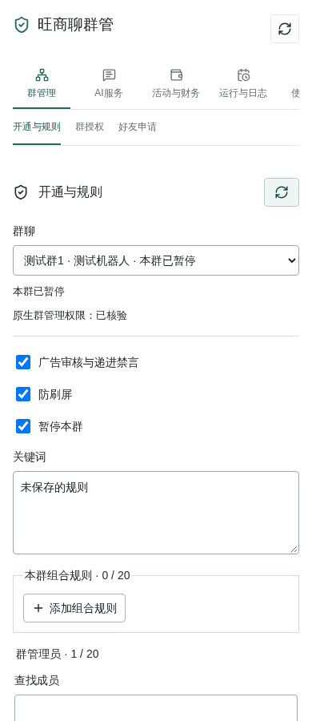
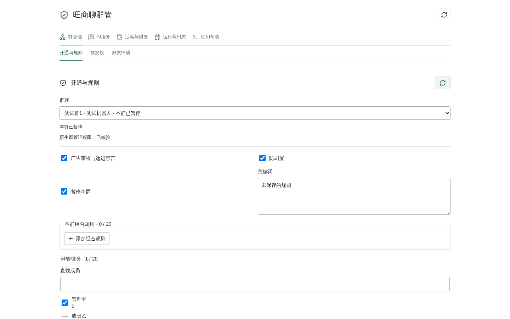

# 旺商聊原生接入器

## 群内与WebUI边界

本轮源码移除全部私信入口：菜单／选群、好友自动审批与欢迎、个人知识、客服、
私信AI、管理员私信指引、私信财务和图片收取。历史会话、知识、账本和审计保留。
群内真实@／可信回复黑白名单、规则命令及WebUI规则、图片、活动与邀请记账／结账保留。
普通群管理员不会自动获得全局后台权限；没有后台权限请现有负责人维护图片或财务。
旧入口逐项映射见[入门指南](wangshangliao-start.md#当前入口群内命令与webui)，
执行边界见[架构与权限](wangshangliao-architecture-permissions.md)。
本轮尚未部署，禁言优先与防袭群也仍待加载和完整实群验收；防袭群默认关闭。

接入说明原校准日期：2026-10-20。入门操作见[从零开始使用](wangshangliao-start.md)，
完整功能与命令见[插件说明](../../../astrbot/builtin_stars/wangshangliao_moderation/README.md)，
全部资料见[文档目录](../../wangshangliao.md)。

### 原生对话、统计与追踪

配置、人格、模型凭证、中文检索分词、技术日志、对话、统计与追踪复用AstrBot原生能力。
群知识的独立归属与版本检查、共享套餐费用预留、财务事务以及固定定时禁言的
逐群授权与执行回执继续由业务模块负责，不改成可调用工具或任意代码的原生Agent任务。
原生对话录入失败只在AstrBot记录脱敏警告，不重复模型调用或发送回复。

## 管理页导航

管理页改为两级标签。先选择功能分类，再选择具体功能；手机端标签横向滚动，
不再把所有入口排成多行，也不在“群管理”里堆叠全部配置。

以下既有截图使用独立模拟群与未保存输入，早于本次群@路由修正；
只示导航位置，不证明现行人格路由或生产群已启用：




## 范围与架构

本接入器在 AstrBot 进程内完成业务认证、加密会话恢复、NIM 连接、目录与身份映射、
文本收发和固定群管理能力。不需要 Rust 服务、DH 工作台、桥接地址或配对令牌。


| 层 | 负责 | 不负责 |
| --- | --- | --- |
| AstrBot | 配置、模型、后台认证与日志；超管额度豁免身份来源 | 旺商聊协议；仅凭admins_id授予公共群管理权 |
| 接入器 | 登录、传输、可信身份、最终动作授权、幂等、回执与恢复账本 | 解析聊天命令或让模型决定权限 |
| 内置群管插件 | 真实邀请开通、逐群管理员、固定规则、排名、活动、计划和只读AI | AI执行管理、跨群越权或绕过执行器协议 |
| 插件管理页 | 模型/规则/逐群授权、活动参数、计划状态与有界审计 | 直接处罚、任意重试或聊天自授权 |

## 部署

使用 Python 3.12+，在项目根目录执行：

```sh
uv sync --extra wsl
cd dashboard
pnpm install
pnpm generate:api
pnpm build
```

内置滑块组件需要 Node.js 和 OpenCV/ONNX，按需启动串行本地工作进程，无需 GPU。
Docker 构建需启用项目的 `INSTALL_WSL` 构建参数。依赖在目标系统/架构重新安装，
不能复制其他系统的虚拟环境、EXE、DLL 或 `.pyd`。部署入口存在不代表所有架构均已实测。

由部署管理员设置 `ASTRBOT_WANGSHANGLIAO_CONFIG` 指向受保护 JSON 文件：

| 字段 | 要求 |
| --- | --- |
| `origin` | HTTPS 服务根地址 |
| `headers` | 协议请求头映射 |
| `metadata` | 14 个整数 |
| `signing_seed`、`body_key`、`message_key`、`server_key` | 标准 Base64 编码，解码后各32字节 |
| `captcha_id`、`app_key`、`device_id` | 有效协议部署参数 |
| `protocol_version` | 新登录的协议版本；`2.8.3`为桌面兼容协议，`3.7.3`为安卓协议，省略时保留`3.7.1`兼容；已保存会话按自身版本恢复，不直接转换凭证 |

Linux/macOS 文件应为 `0600`；Windows 使用仅服务账号可读 ACL。参数不得写入教程、
聊天或截图，也不从浏览器接口返回。缺失为 `deployment_missing`，不合格为
`deployment_invalid`。旧配置缺少 `message_key` 可以认证，但消息启动报
`message_key_missing`，不能把登录成功当收发就绪。

未设置环境变量时可加载已批准导入的
`data/platform_data/wangshangliao/deployment/` 密封配置；显式路径无效时不静默回退。
导入协议配置不导入旧账号密码或账号会话。

`ASTRBOT_YIDUN_SOLVER_URL` 未设置或为 `builtin` 时使用内置求解器；
空值使用人工流程；外部 HTTP 求解服务为兼容选项。自动失败保留人工验证。
`.venv/bin/python scripts/check_wangshangliao.py` 做不联网、不打印凭证的预检，
预检通过不等于真实平台验收。

## 登录、保存与停用

| 状态 | 核对方式 |
| --- | --- |
| 认证成功／尚未保存 | 完成保存后再核对消息连接，不能视为在线 |
| 连接状态待核实 | 未取得实时状态，不当作停止或0群 |
| 群列表读取失败 | 核对业务认证及群目录权限，不用旧列表冒充当前结果 |
| 业务暂停／已启用群0 | 分别核对实时业务开关和有效群范围，不据0群推断暂停 |
| 历史错误记录 | 保留历史，不代表当前故障仍存在 |

`1400`是平台认为未设置安全码，`1402`是本次登录尚未验证，不能混为一谈；
`1403`错误后至少等待30秒，`1404`锁定时先在官方App核对，`1405`先绑定手机号。
验证成功但消息令牌读取失败时，仅重试消息连接，不再次提交安全码。
验证结果不明时停止重试，取消后重新登录；不要在后台、日志或截图公布安全码。
安全验证成功回执不要求强制更换登录凭证：优先使用响应头的新凭证，其次使用
成功正文的新凭证；未提供新凭证时保留本次登录凭证，继续获取消息令牌。
没有新凭证、或新旧凭证相同，不应被误判为安全码错误。明确失败、损坏的响应
或网络结果不明仍停止，不重发安全码；消息令牌未确认前不能保存为认证完成。

新版密码、短信登录均提交已核验发布包对应的 `version`、`appVersion` 和
`appHash`，并非只更新请求头。3.7.3 对应版本号为335；发布包变化需重新核验，
不能根据文件名猜测或沿用旧包摘要。`1001` 是官方通用错误，不代表密码错误、
账号封禁或安全码错误；后台保留数字错误码，不记录上游原始响应或凭据，
也不会自动重试登录。离线测试通过不等于真实账号重新登录成功。

登录事务绑定后台用户与预分配实例，保存后才持久绑定账号并连接 NIM。
认证成功、配置保存和消息在线是三个独立状态。后台密码不等于旺商聊密码。
接入页“业务运行中／业务暂停”和“已启用群”读取该实例的实时业务状态，
不是从不含业务字段的登录配置推断；尚未读取状态时显示“业务状态待核实”。
接入页同时显示当前连接的原因及处理建议；未读取到连接或启用群数时显示“待核实”，
不直接当作离线或0群。错误详情入口显示“历史错误记录”，在线恢复后仍可保留历史记录，
不代表当前仍然故障。未知错误只显示固定说明，不将平台原始响应作为提示输出。

业务暂停以实例实时开关为准，不能由“0个运行群”或账号离线反推。
运行群数只计已开通、在群、未暂停且成员核验无待处理状态的群；
未通过开通核验或容量暂停的群不计入，不能只数已保存的群记录。
消息连接在线但群目录接口明确返回需重新认证时，页面单独提示重新登录；
消息连接状态不因此伪装为离线，也不能据此宣称成员查询或结账可用。

`business_auth` 单独报告业务凭证状态及实际设备类别，不含设备编号、凭证或
密钥。`credential_present` 只代表持有凭证，不代表已验证所有接口可用。
任一业务接口收到明确 `401` 后，立即将其标记为 `expired`，后续业务请求
在本地拒绝；即使群目录曾读取成功，页面也会提示业务登录失效，不再只显示
绿色“账号已在线”。暂时的网络错误及 `1400` 不冒充设备冲突。

### 手机与机器人登录

程序运行在服务器上不等于使用桌面端登录。官方设备分类中 `1` 是桌面、
`3` 是安卓；安卓 `3.7.3` 登录同时绑定安卓设备类型、客户端标识及签名版本，
可能与手机登录相互影响，不能据此宣称官方禁止手机与桌面端同时在线。

新增桌面 `2.8.3` 兼容分支，对齐发布包中的桌面签名版本、设备类型和客户端
标识，并使用当前 `get-nim-token` 路径及持久化消息设备编号。桌面登录仍需
验证服务器返回的绑定令牌；要求安全验证时仍须完成，不能伪造或跳过。
不会仅把安卓凭证的设备类型改成桌面，也不伪造安卓安装包校验字段。

IM 连接会保留当前令牌接口返回的静态、动态或回调认证类型，并将其传给消息
服务；回调令牌不能当作静态令牌使用。未知类型直接拒绝，不尝试降级为静态
令牌，也不把令牌或认证响应写入诊断日志。旧接口未返回类型时保留静态兼容。

由部署管理员选择新登录协议后，通过后台重新登录并保存才会使用新分支。
已保存的安卓、旧版和桌面会话均按各自协议恢复；更改部署或重启不会转换
已有凭证、重置设备编号、自动重新登录或清除账本。桌面分支的离线回归通过
不等于手机共存已验收，仍须取得重新登录及手机再次登录后的真实读取证据。

连接在线、群列表可读、完整成员可读及业务已启用是独立检查项。
成员查询失败不再统一误报“开放服务未连接”：后台区分身份冲突、名单不完整、
响应超限、平台拒绝、安全验证和限流，技术诊断使用 AstrBot 原生日志并脱敏。
不使用部分成员资料授权或结账，不通过自动重试掩盖读取错误。

运行状态的 `receive_health` 分开记录未处理的非聊天推送、无效数据包、
消息解码失败及暂不支持的消息格式；`decode_reasons` 只包含固定失败阶段，
不记录消息正文、密文、密钥或原始平台响应。非聊天推送不再增加
`unsupported_pushes`，但仍保留独立计数，不声称已经支持对应通知。
`decoded_messages` 记录实际通过解析的消息数，`decode_shapes` 仅汇总有界的
协议字段编号和类型，不包含字段值，便于区分尚未兼容的封装。
接入页只对实际解码失败显示独立提醒，不以历史总数判断当前登录失败。
累计计数属于本次运行，旧的“未支持推送”总数无法事后还原为这些分类。

接收同时兼容旧消息封装及官方 3.7.3 的 `MessagePacket` 第1版：
先验证独立认证数据，再验证内层消息；不能用封装中的账号资料授予权限。
零压缩标记的消息仍须通过认证和路由核对，不将其直接当作可信明文。
未知封装版本、嵌套封装及任一认证失败均拒绝，普通消息的1MiB上限不变。
同时兼容官方编码器允许的整数变长／定长编码；同一字段的矛盾编码拒绝。
实测仍有缺少认证字段的封装，这部分继续拒绝，不据此声称所有消息已兼容；
它们不会进入群管、AI或结账，需取得可信格式依据后再增加支持。

停用并保存关闭连接与处理任务，保留恢复会话；退出账号删除本地恢复凭据，
不擦除历史账本。重新登录先建立临时认证，成功保存时再替换旧连接及本账号会话；不同账号须新建实例。`reauth_required`
需要重新登录。切换系统时先停止旧回复系统，不让两套自动化同时处理同群。

## 实例配置参考（公共模式由群管理覆写）

这些是保存配置的字段，不是要求用户直接编辑密封会话；优先使用后台，未知字段会拒绝。
公共模式通过账号／群租户生成独立运行视图，启用群、逐群关键词和自动审核取租户设置。
强制关闭语义模型审核、强制开启递进撤回逻辑并禁止自动踢人；不要用下表旧配置恢复群AI或工具。

插件 API 提交字段名 `customer_provider_id`，实际保存为
`ai_routes.groups["业务群ID"] = "模型ID"`；空映射值为继承，不能写
`{"customer_provider_id": "…"}` 作为该映射值。

| `moderation` 字段 | 默认/范围 |
| --- | --- |
| `enabled`、`automation_enabled`、`recall_enabled` | 缺省false；分别为能力总开关、自动化、违规撤回 |
| `permissions` | 群ID到动作列表，最多100群；必须显式保存 |
| `cooldown_seconds` | 默认60，整数10至86400秒 |
| `mute_keywords`、`kick_keywords`、旧 `keywords` | 各最多50条，每条非空、最多100字符；旧值仅兼容 |
| `semantic.enabled` / `provider_id` | 默认false/空；独立审核模型 |
| `semantic.timeout_seconds` | 默认12，整数1至30秒 |
| `semantic.context_limit` | 默认20，整数1至50条；仍受近期同群窗口限制 |
| `auto_kick` / `card_auto` | 群ID到布尔值，缺省false；逐群独立开关 |
| `card_suffix` | 群ID到后缀文本，缺省空；最多128字节，不含换行/控制字符 |
| `progressive_mute` | 默认false以兼容旧配置；实例级，开启须同时启用撤回，每轮三次警告后按1/3/10分钟禁言，10分钟结束后重开一轮 |
| `manual_kick_only` | 实例级限制；当前接收机器人为true，拒绝AI及自动踢出，不能由AI配置工具修改；与任一true的 `auto_kick` 不兼容 |
| `content_rules_since` | 业务规则生效时间；后端维护，不通过聊天任意修改 |

管理页“当前群”也显示新加入但未启用的群，标注“未启用”且不能选择执行操作。
群名刷新最长缓存30秒；在“群聊与运行”勾选并保存后才进入处理范围，不自动授予
禁言、撤回、主动发送或邀请返现权限。

默认关键词文件包含47条规则，用于兼容实例配置和首次开通的默认模板。
公共模式按账号／群的持久化列表执行，默认文件更新不会覆盖已开通群；
已有定制和显式清空保持不变，未开通群不自动启用。
“宋、58、兼职、小额、蛋糕、P图”等泛词需广告上下文，域名后缀还需真实域名
边界；举报、引用、普通数字及单独链接不直接处罚。显式空关键词列表仍保持为空。

2026-10-17 根据本地保留、可对应管理员撤回的原文，补充收款账户截图招募、社交账号
限时返利招募、“附近的人”小时报酬招募、黑料及付费预测引流、担保项目招募，
以及“免废劈图上分”等组合规则。不单独封禁“网红”“担保”“预测”等泛词，
不根据缺失原文猜测图片内容。通用组合也适用于公共群空关键词列表，但不绕过本群广告
开关、消息时效及权限，不追罚历史消息，不开启未启用或暂停群。
详见[内容规则与样本边界](../../wangshangliao-content-rules.md#管理员撤回样本补充)。

2026-10-20 继续对照人工撤回原文，新增注册赠送彩金、做单加联系方式、附近人小时报酬、
带群号的项目招募、付费转发拉群和带联系人号码的赔率招揽组合。金额、联系方式、
招募等条件须按各自模板共同成立，普通聊天、独立号码、举报与引用不据此处罚。
不将人工撤回等同违规，不把争吵或骚扰误标成广告；不新增模型调用或历史扫描。
新规则自动适用于广告审核已开启的群，保留各群自定义关键词和原处罚流程。

2026-10-20 补充“免费上分”和“没米上分的来找我”等明确招揽短句。新数字联系方式
可关联本账号本群前120秒内最多64条实时消息，但仅用同一发送者、同一规则版本的证据：
明确引流后发号码，或“开播”后重复同一号码至少两次。单独号码、普通报数、举报和历史补采
不因此处罚，原刷屏阈值不变。处罚记录优先展示本群当前成员名称，并在下方保留账号；
目录无名称时仅按同账号、同群、原消息及发送者匹配补充“历史名称”，无可靠记录才显示
未获取；不从其他群猜测，也不将展示名称作为身份依据。

「处罚记录」将原消息撤回、警告发送、历史警告自动清理分开显示，类别与状态使用中文。
2026-10-20警告修正已随上述完整后端重启加载：原生`warning`不再强制`auto_recall=False`或信任调用方`userName`／ID标签，
而从本账号本群权威完整成员名单精确核验UID／NIM，使用真昵称原生@；身份可信但缺昵称时只发正文，
身份不一致仍不发送。`auto_recall=True`在实际发送回执后安排12秒撤回，警告失败不抹去原消息成功撤回。
加载阶段未发真实警告；随后三账号在`1459282`使用两个隔离fixture（1＋2次）完成3次警告实测，
不是同轮完整三级升级。原生`userNick`的`@大蛤`及目标身份正确，不优先使用群名片`testfork`；
原消息与警告均有对端撤回证据，警告受理后12.112／12.115／12.125秒收到撤回通知。
规则、临时管理员角色恢复为原普通成员，窗口关闭，正式群、财务及正常处罚计数未变；
实测0模型调用、无额外NIM连接、未重启服务，原生回执及最小审计保留。
仅昵称与警告撤回通过，禁言升级、全功能和手机显示不在本轮范围；
详见[当前测试入口](wangshangliao-testing.md)。
619项通过早于缺昵称回退细化，仅保留为历史，不作为最终验收；最终离线结果见[当前架构与权限](wangshangliao-architecture-permissions.md)。
新增「撤回来源」单独展示机器人执行回执、命令/回复清理、本人或其他成员撤回，
不把人工撤回写成违规处罚；只读、有界、按本账号本群去重，未知来源明确标记。
平台受理不等于已读，收到撤回通知也不代表已取得手机画面证据。

固定动作白名单：`mute`、`unmute`、`kick`、`recall`、`announce`、`mute_all`、
`unmute_all`、`rename`、`cleanup`。清理不继承踢出/名片授权，自动名片开关另需 `rename`。

机器人页“机器人群管授权”选择目标群，勾选“修改普通成员群名片”，
填写“本群名片后缀（可留空）”，再开启自动规范并保存。
插件页对应“当前群动作授权”，也可编辑后缀。规则为现有群名片前两个完整字符加后缀，
群名片空则用账号名称；单字名称不补字，空名称使用持久化备用名。
例如“张三丰”加后缀“·群员”得到“张三·群员”，反复扫描不叠加。
公共模式名片设置仅在总控后台维护，没有聊天或AI修改入口。
群主、管理员及已接入机器人受保护。400 `moderation_permission` 应先核对已保存的
群管总开关、目标群名片动作授权，以及机器人在平台的管理员身份。

## 身份与会话

| 标识 | 用途 | 不能替代 |
| --- | --- | --- |
| 实例 ID，如 `wangshangliao_…` | 机器人实例及账本分区 | 旺商聊用户 UID |
| 业务用户 UID | 管理员身份、原生 At 的 `qq`、成员身份 | 昵称、手机号、NIM 账号 |
| 显示账号 | 客户端展示 | 业务 UID |
| 业务群 ID | 启用群、API 与动作授权 | 客户端显示群号 |
| NIM ID | 传输与目录映射 | 聊天管理员 UID |

不按昵称、手打 `@名字` 或群号猜身份。分页缺失、重复游标、映射冲突时不使用
不完整目录执行管理动作。群名片优先展示，昵称其次；身份校验仍使用稳定标识。

## 主动发送与结果

后台鉴权文本入口 `POST /api/v1/im/messages` 使用已知 `umo` 与 `message`
组件数组；`plain` 携带文本，`at` 的 `qq` 为**字符串业务 UID**，
不接受 NIM ID、昵称或伪造全员提及。请求/结果遵循接口的操作 ID 与去重契约。
通过 `GET /api/v1/im/operations/{operation_id}?platform_id=实例ID` 查询结果，
不要用重复发送来查是否成功。

发送需要后台 JWT 或具备 `im` 范围的受支持 API 凭据，不在文档提供认证绕过方式。
使用调用方稳定 `operation_id`（1至256字符）：同一业务操作查询/重试沿用该 ID，
新业务操作使用新 ID，不能把改正文当旧操作重试。未传 ID 会产生新操作，不适合结果不明时重发。
示例仅示意参数，不提供实际可发送的路由：

```json
{
  "umo": "从已有会话选择的UMO",
  "operation_id": "caller-owned-unique-operation",
  "message": [
    {"type": "plain", "text": "测试通知 "},
    {"type": "at", "qq": "已核验成员的业务UID", "name": "成员名"}
  ]
}
```

| 状态 | 含义与处理 |
| --- | --- |
| `accepted` | 上游已受理，不保证对端看到或动作已回读 |
| `verified` | 对应能力通过后续状态核验 |
| `rejected` / `failed` | 拒绝或明确失败，先检查原因 |
| `unknown` | 请求可能已执行，不盲目重试 |
| `needs_review` | 处理中断，保留现场人工核查，不自动重新生成 |

## 持久化、撤回与输出

业务目录为`data/platform_data/wangshangliao/<64位目录名>/`：
`session.key`、`session.sealed` 及消息、群管、名片、活动、每日计划 SQLite 账本。
合并模式通过受保护的`account-roots.json`绑定账号到原目录，实例重建不以改名搬库；
初次绑定沿用实例ID的SHA-256。不得按新实例ID猜目录后清除原绑定或旧账。
密钥和密文同机不对主机管理员保密；备份按凭据管理。
消息先落库再确认，控制、固定命令和普通消息分槽，保持有界积压与同会话顺序；
当前槽位和限额见[维护说明](../../wangshangliao-maintenance.md)。
重启不重放已处理或结果未知的业务动作。

自动撤回工作器按已提交任务和最近到期时间唤醒，空队列保留30秒兜底检查，
不再每半秒查询数据库；新任务提交后立即唤醒，到期仍核验原账号、群和权限，
结果不明不重放。日常撤回通知观测使用 AstrBot 的 DEBUG 日志，执行回执、
警告和错误仍保留原级别；关闭 DEBUG 时不计算这些日志的身份摘要。

AI 结果转纯文本、保留链接与 At、关闭本平台 AI 结果文字转图片。
出站文本过滤已配对的 `think/thinking/thought/analysis` 标签块、
开头未闭合标签及孤立闭合标签，缓解模型把推理标签当正文发送。
不是全流式/所有推理过滤，也不清理日志和历史；过滤后可能无可见正文。
凭证、手机号和邮箱为有限规则遮盖，不是完整 DLP，也不阻止原文进入模型。

## 开发测试与排障

验证入口见[测试与验收](wangshangliao-testing.md)，
备份见[维护说明](../../wangshangliao-maintenance.md)。
文件日志/调用追踪只恢复当前文件末尾有界记录，不是全量归档；
无手工标题的会话以已知名称/账号兜底，不额外调用模型生成标题。
