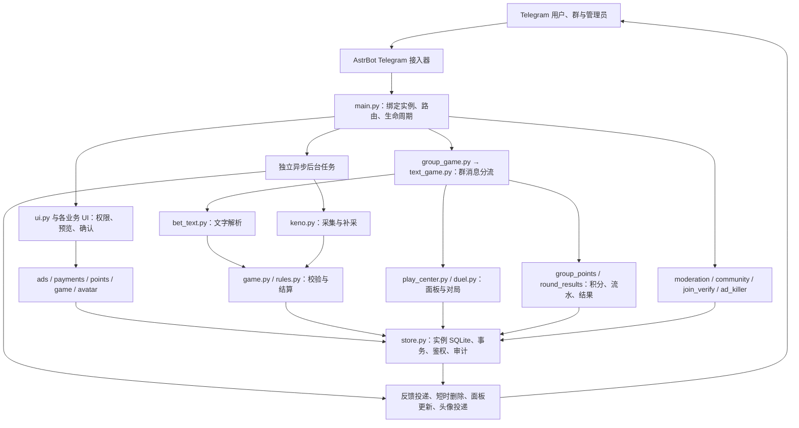

# 当前导航补充

完整普通用户／总控私聊树状图见 [private-menu-tree.md](private-menu-tree.md)。
本群【功能启停】仅包含六项娱乐、AI客服、制图；【每日娱乐时段】仅娱乐，并可返回上一级。
AI／制图默认授权、共享总控内容，不提供群级模型／模板定制，显式限制和全局安全额度继续生效。
下文全局维护工具不等于单群页面；旧重复总览已合并到功能启停。

# 功能说明与运行架构

核对日期：2026-10-04。本文供维护和业务管理员阅读，不导入玩家客服知识库。

## 管理入口

统一从「我的群」先选群。原「管理中心」及其旧版按钮不再展开平铺菜单，点击后回到「我的群」；历史本BOT群仍按原权限显示。

持有本BOT业务授权的管理员另见「本BOT总控」：功能总开关、全局业务策略、历史广告维护等。首位超管还可进入「接入与收款规则」「授权管理」。普通群主不获得这些权限；授权与撤权不再平铺在首页。以下为底层维护能力，不代表首页有同名按钮。

| 入口 | 用途 | 边界 |
|---|---|---|
| 全部功能启停 | 广告发布、玩法中心、积分获取、群管理及各玩法总开关 | 不配置逐群参数；广告充值仍使用独立后台配置 |
| 广告管理 | 广告位、订单审核、核款、投放目标和异常核查 | 内容审核不等于收款；自动说明不代表外部到账核验 |
| 积分管理 | 签到与聊天奖励、人工调整 | 按群账本隔离；派送按群核验成员，分步加减，不需原因 |
| 玩法管理／加拿大28 | 倍率档位、限额、开放时段、采集异常 | 总开关之外仍校验群状态、余额、数据时效和封盘 |
| 玩法管理／积分快三 | 逐群启停、近期8期、骰子投递及异常退款 | 未知发送不重掷；仅待核查且未结算期可退款 |
| 玩法管理／逐群对赌 | 当前群对赌启停、进行中数量 | 还受玩法中心和对赌总开关约束；不扣积分、不担保彩头 |
| 玩法管理／其他互动玩法 | 转盘、老虎机与扫雷的逐群开关、桌次和异常 | 各玩法总开关与逐群开关互不覆盖 |
| 群管理 | 登记群、群策略、处罚、广告检测、入群验证、举报 | 业务授权和 Telegram 实际群权限均需满足 |
| 专属头像管理 | 制作开关与任务查询 | 数字 UID 累计额度，不按群重复赠送 |
| 授权与撤权 | 授予／回收业务管理权限 | 仅首位超管，业务管理员不可转授权；不授予服务器登录权 |

## 开关不是删除数据

- 关闭玩法后，已受理订单及已锁定对赌仍按保存的规则处理；不退款撤单、不改历史结果。
- 关闭积分获取，不清空余额，也不停止已有订单的结算入账。
- 关闭广告发布，已有广告到期清理仍运行。
- 关闭玩法中心同时暂停未来追号。关闭群管理会关闭定时禁言和广告杀手策略；重新开启总开关不自动恢复这些策略。
- 对赌配置和挑战按群隔离。新增群自动创建默认配置并启用，群管理员可自行关闭。
- 头像提交、轮询、成品投递是独立任务；未知发送结果不自动重发。

## 开启本群娱乐

「我的群 → 当前群 → 功能启停」逐项预览并确认。只改本群、不改全局开关、其他群或已有订单。
「每日娱乐时段」分开始、结束、确认三步，仅六项娱乐的新参与受限。
玩法独有参数在「玩法设置 → 对应玩法」，没有重复的启停或总览按钮。

### 数值设置

转盘档位每次发送一个数字，发送“完成”进入确认；“上一步”移除最后一档。新增广告位先填写名称（可含空格），再单独填写价格。测试群主名单逐个填写 UID，最后发送“完成”；发送“无”预览清空。以上输入错误均保留当前草稿，最终确认前不写业务配置；`/cancel` 可放弃。

每日禁言先填写开始时间，再填写恢复时间（北京时间，`HH:MM`）。群管授权依次填写目标 UID、有效天数，再逐个添加群 ID，发送“完成”预览；两者均支持“上一步”，确认前不生效。

群主配置奖励、玩法限额和成员积分时，系统会逐项提问并保存草稿：每条消息只发送一个数值，按提示完成后再预览确认。老虎机和扫雷档位逐个发送 `100`、`300`、`800`、`1500` 或 `2000`，最后发送“完成”；发送 `/cancel` 或返回上级可放弃未保存的草稿。未点击确认前不会修改配置。

## 实际组件图

这是一套插件内的异步模块，不是多套独立微服务。`Main` 复用已绑定的 Telegram 接入，不额外启动第二个 polling。后台循环与业务入口分离，不用并行线程写共享 SQLite。

## 数据及权限边界

- **机器人实例**：本BOT ID 对应独立数据库目录。
- **群积分**：`group_wallets`、`group_ledger` 按群和用户隔离。
- **对赌**：`duel_groups` 保存逐群开关，`duels` 保存群、双方、期号和规则快照，`game_panels` 保存面板投递状态。
- **反馈与删除**：`gt_requests`、`gt_delete` 持久化发送和撤回状态；不能猜测未知消息 ID。
- **授权**：插件业务角色、对应群范围、Telegram 实际权限分层核验；显示按钮不代表一定获准执行。
- **资金边界**：广告余额与积分账本分开；对赌没有扣积分或自动履约机制。
- **外部依赖**：Telegram、Keno、头像上游、充值扫描可能分别失败；不将模型当作下注解析器或扣分决策器。

## 维护检查顺序

数据库垃圾清理及索引维护见[操作手册](database-maintenance.md)。先只读预览和一致性备份，后执行白名单清理；测试订单若已产生积分或收款，仍按业务证据保留，不能直接删单。

1. 查总开关，再查群启用、逐群开关和业务参数。
2. 查角色有效期及 Telegram 实际群权限。
3. 查数据时效、任务状态和失败原因，区分业务拒绝与网络失败。
4. 对未知发送先核查，不自动重发；只清理有精确 ID 的机器人消息。
5. 修改前做一致性快照；热加载等待后台退出，不覆盖整库回滚新流水。

## 多群主共用机器人

「我的群」仅列出本人仍是 Telegram 群主或管理员、且机器人仍具备管理权限的群；超管身份不提供跨群管理入口。有效授权账号在私聊底部键盘进入「本BOT总控」，按当前授权展示全局功能；普通用户不显示。广告位、收款和群订单仅由该群经营群主操作，旧按钮和最终确认同样重新核验。

新增群自动启用基础业务。使用前仍核验本BOT总开关、本群服务、本项功能、Telegram 管理员身份、机器人权限和业务数据状态；管理员关闭后显示明确的本群停用原因。

本群服务关闭时，群主仍可进入转盘、快三、老虎机和扫雷管理页，预先配置运营参数及查看记录；保存参数不会自动开启本群服务或接受下注。身份、归属和机器人权限照常核验。老虎机显示本群开桌档位，同桌与发起者同额；扫雷显示本群加入档位。

广告独立链路为“审核 → 预留 → 付款 → 核款 → 发布”。历史本BOT广告余额继续只服务本BOT业务；新经营者直付广告不经过旧余额，也不进入游戏积分。到账异常只进入核查，不自动发布。

付费 AI／制图预算只由兼具本群经营群主身份的本BOT超管按群授权，预算为次数上限而不是金额额度；调用身份、群、资源和次数写入审计，重复操作不重复消耗。未授权或预算耗尽时应拒绝请求，不回落到其他群或本BOT余额。
