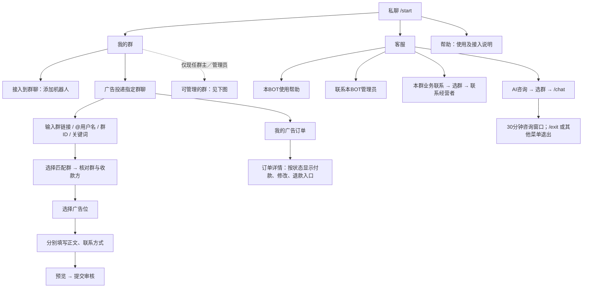
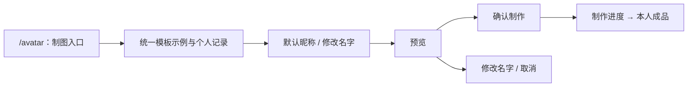
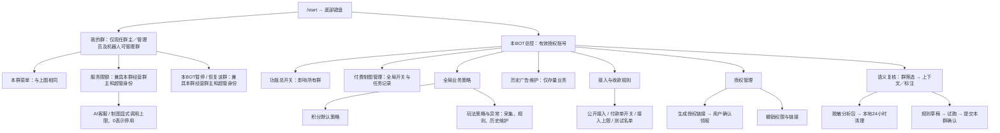

# 私聊按钮功能树

对应 2026-10-06 的私聊路由。实线表示按钮进入下一层；图中的输入步骤不是额外常驻按钮。
普通用户底部键盘为「我的群、客服、帮助」；有效总控授权账号增加「本BOT总控」。
底部按钮按当前授权刷新，旧回调与确认步骤仍重新验权。

## 普通用户

没有可管理群是正常状态，普通成员仍可搜索广告投递目标或在客服入口选择自己所属群。
旧充值和余额支付入口已停用。订单审核通过且条件满足才生成直付付款单，不会在搜索时收费。

### 制图独立入口

不是底部常驻按钮；通过 `/avatar` 或已发布的头像入口进入，使用总控固定模板。

默认授权不等于无限调用：总控制图总开关、有效群成员核验、固定昵称规范、个人次数、全局任务额度和供应商凭据继续生效。
群主不能替换模型、系统提示词、知识库或图片模板。昵称输入不等于可定制绘图指令。

## 群主／现任群管理员：普通用户的条件分支

```mermaid
flowchart TD
    M["我的群 → 选择可管理群"] --> S["功能启停"]
    M --> OWN["确认经营归属：历史自动接入误登记时显示"]
    OWN --> OC["本群管理员确认 → 核验并登记真实群主"]
    M --> RE["确认重新接入：退群暂停且归属正常时显示"]
    RE --> RC["本群管理员确认 → 复核身份 → 恢复基础服务"]
    M --> MG["群管"]
    MG --> MA["广告与刷屏"]
    MA --> MR["语义检测：授权告知 → 开启／暂停 → 样本标注 → 清理"]
    MA --> MK["检测规则与命中记录"]
    MG --> MV["入群验证／欢迎与群规"]
    MG --> MM["成员管理：禁言／解禁／踢出／封禁／删消息"]
    MG --> MB["全群禁言：立即禁言／恢复／定时计划"]
    MG --> MC["举报处理／操作记录"]
    S --> E["六项娱乐：逐项开启 / 关闭"]
    S --> AI["AI客服：开启 / 关闭"]
    S --> IMG["制图：开启 / 关闭"]
    S --> T["每日娱乐时段"]
    T --> TS["选择娱乐 → 开始时间 → 结束时间 → 确认保存"]
    T --> TB["返回上一级：功能启停"]
    S --> SB["返回上一级：本群管理"]
    M --> P["积分与奖励"]
    P --> PR["设置奖励：签到 → 聊天 → 间隔 → 每日上限"]
    P --> PG["派送积分给群员"]
    PG --> PI["@用户名 / 用户链接 → 核验身份"]
    PI --> PD["+积分 / -积分 → 数量 → 确认 → 群通知"]
    M --> G["玩法设置：只列六项娱乐"]
    G --> GC["加拿大28：下注限额"]
    G --> GK["积分快三：限额、近期8期、异常核查"]
    G --> GW["积分转盘：档位、每日次数、冷却"]
    G --> GS["老虎机PvP：档位、桌次、托管记录"]
    G --> GM["扫雷接龙：档位、桌次、异常记录"]
    G --> GD["双人对赌：近期场次、固定规则"]
    M --> AD["广告位与订单：经营者权限"]
    M --> AC["收款设置：经营者权限"]
    M --> CT["本群业务联系：经营者权限"]
    M --> ER["异常记录：经营者权限"]
```

群管理员的本地权限不包含经营者财务权限；收款、广告位、广告审核和群订单仅经营群主可操作。
归属核验和基础服务恢复允许本群现任管理员代为确认，不将其登记为经营者。
已有广告订单或收款配置的归属变更须人工核查；不会恢复待核查广告、语义采集或定时管理。
所有本群参数仅对当前群生效；每次确认重新核验 Telegram 身份，过期或撤权的旧按钮不能执行。
六项娱乐为加拿大28、积分快三、积分转盘、老虎机PvP、扫雷接龙、双人对赌。

## 总控：初始及受授权超管私聊

初始超管与已领取有效 `超管` 授权者共用完整总控和授权能力；
`全功能` 业务管理员只能看到业务管理分支，不会自动升级或转授超管权限。
业务管理员的底部键盘也显示「本BOT总控」，其中只显示已授权的全局业务分支。
超管身份不使其他人的群出现在「我的群」，也不能绕过旧按钮审核其他群的订单；
免付款测试投递须同时具备超管和该群经营群主身份。
新超管先私聊机器人发送 `/start`，由现任超管按「授权管理 → 生成授权链接」
选择目标账号、超管、期限，目标本人领取后生效。初始恢复账号不可在私聊撤销。
模型、知识源、制图模板、凭据和全局额度来自总控统一配置，不是群级私聊自定义表单。

## 返回和兼容路径

| 当前页面／旧入口 | 返回或替代路径 |
|---|---|
| 每日娱乐时段 | 返回上一级 → 功能启停 |
| 娱乐的开始时间 | 返回每日娱乐时段 |
| 娱乐的结束时间 | 返回上一级 → 重新填写开始时间 |
| 功能启停 | 返回上一级 → 本群管理 |
| 玩法详情 | 返回玩法设置／返回选群 → 我的群 |
| 旧本群玩法总览 | 功能启停，不直接改开关 |
| 旧广告／积分／本群服务启停按钮 | 拒绝执行，提示入口范围已调整 |
| 旧每日功能时段里的非娱乐设置 | 拒绝新保存；旧值保留但不参与业务准入 |
| 旧充值、余额支付 | 停用；使用指定群直付广告 |
| 旧群管大面板 | 成员管理与全群禁言分开；广告、举报和记录在群管上一级 |
| 旧群虚拟键盘按钮 | 拒绝执行；不再出现在群管页面 |

## 代码对应关系

- `ui.py`：私聊主入口、总控和输入分流；`tenant_ui.py`：单群页面及广告流程。
- `game_registry.py`：六项娱乐及八个本地开关唯一清单，供菜单和每日时段复用。
- `game_navigation.py`：四种玩法详情的权限包装及一致返回路径。
- `game_schedule.py`：仅六项娱乐的每日准入窗口；不定时翻写开关，不中断已受理结算。
- `tenants.py`：群归属、请求级管理员权限、共享服务默认授权及总控显式限额。
- `support_menu.py`：客服分流和明确选群；`main.py` / `avatar_ai.py` 继续使用同一总控模型、人格和固定模板。
- `semantic_review.py` / `semantic_review_ui.py`：默认关闭的授权采集、人工标注、受控分析包、试跑草稿、逐群确认与清理。
- `store.py` / `points.py`：原子积分流水与持久群通知；历史资金证据不属于可删文件。
